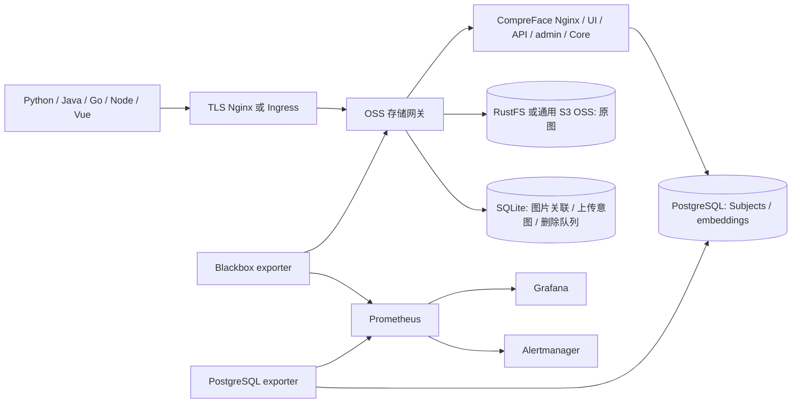

# 架构

生产 Compose 和 Kubernetes 使用 CompreFace 1.2 全功能镜像，通过 EXTERNAL_DB 和 JDBC 连接外部 PostgreSQL。测试 Compose 使用镜像内部 PostgreSQL，并持久化正确的 PGDATA 路径。CompreFace admin 负责数据库迁移。

服务密钥按 Detection、Recognition、Verification 分类；业务用户所有权由应用层实现。SDK 按服务选择密钥并归一化后端响应。特征提取结果的 Base64 是跨语言二进制编码，不构成加密。

模型由 CompreFace Core 执行，模型和插件能力以实际镜像为准。主部署设置 SAVE_IMAGES_TO_DB=false，由网关在注册前保存原图，并使用持久化 journal 协调异常恢复。图片读取检查服务权限与后端当前 image_id，删除后立即撤销读取，OSS 故障时保留待删除队列。Redis 是可选应用基础设施。没有独立活体检测服务或 quality 插件实现。详见 [对象存储](object-storage.md)。

依赖可用性通过 API consistence JSON 监控，数据库由 PG exporter 监控。没有虚构的 HTTP 业务指标、宿主 CPU 指标或未部署的导出器。Alertmanager 未默认配置外部通知。

现有配置提供单数据库实例与持久化，不实现数据库故障切换、跨区复制、Redis Sentinel、向量/图片存储加密。传输 TLS 依赖提供证书并启用 gateway/Ingress；存储、备份加密及恢复演练由部署环境配置。扩容、真实模型精度和吞吐量需独立验证。
