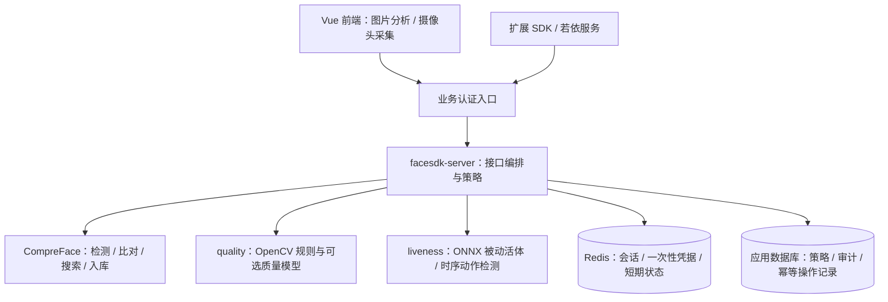

# FaceSDK 活体检测与人脸质量插件实施方案

编制日期：2026-10-11。状态：设计方案，尚未实现。依据当前工作区代码与 CompreFace v1.2.0 官方插件文档；尚未对部署实例、候选模型或真实摄像头做实测。

## 1. 结论与范围

建议增加独立的 `facesdk-server` 扩展服务，使用 Python + FastAPI + OpenCV + ONNX Runtime，实现 `quality`、`liveness` 两个插件以及服务端业务准入策略。保留 CompreFace 作为检测、特征提取、比对和搜索引擎，Vue 前端增加插件展示、摄像头采集及质量反馈。

默认面向普通 RGB 摄像头和人脸图像质量。质量表示图像是否适合识别；活体表示对照片、屏幕回放等呈现攻击的检测结果。检测置信度、身份相似度、图像质量、活体分数分别定义，不能互相替代。

交付分两层：

- 图片分析：质量检测、单图被动活体评分、逐人脸结果展示，适用于分析调试和辅助筛选。
- 业务验证：摄像头连续采集、服务端活体会话、样本绑定、一次性凭据、服务端强制策略，适用于注册与身份复核。强业务接口不能仅凭浏览器提交的 `passed=true` 放行。

上传照片的被动活体结果不能证明“此刻本人在场”。动作挑战结合被动活体能增加攻击成本，但普通浏览器无法可靠证明视频来源，对虚拟摄像头、实时换脸等攻击应另行评测；高风险场景可接入经过评测的厂商 SDK 或可信深度/红外设备。第一阶段不承诺防御所有攻击类型。

## 2. 已核对的项目现状

| 项目位置 | 现状 | 对本次设计的影响 |
| --- | --- | --- |
| `docker-compose/docker-compose.yml` | 使用 `exadel/compreface:1.2.0` 一体镜像，没有自有推理服务 | 必须增加可执行后端与模型部署，单改前端参数无法完成 |
| `facesdk-web/src/api/face.js` | `/api/v1` 直连上游，按路径选择三类服务 Key | 扩展接口应使用独立客户端与认证，避免错误选 Key |
| `facesdk-web/src/views/DetectView.vue` | 支持 age、gender、pose、landmarks 勾选 | 增加插件能力查询、勾选项和结果组件 |
| `sdk/openapi/compreface-api.yaml` | 描述原生 CompreFace 协议，无活体与质量字段 | 新增扩展 OpenAPI，不能把自定义字段写成官方能力 |
| Java/Python/Go 的 Face/Quality 模型 | 有 `score/brightness/sharpness` 字段，没有计算链路；缺失子字段通常落为数值零 | 新协议使用明确状态和可空指标，避免把未执行解释为低分或通过 |
| `sdk/nodejs/index.js` / `index.d.ts` | JS 展开保留插件字段，TS 缺少具体插件类型 | 增加明确类型和新客户端；不能只改返回 JSON |
| `examples/ruoyi-integration/FaceService.java` | 注册和人脸复核检查单人脸后调用入库/搜索，无质量、活体门禁 | 业务侧改用服务端受保护接口 |
| `FaceController.java` | 类级 `isAuthenticated()`，服务端限制本人操作 | 当前 `/face/login` 实际属于已登录用户身份复核；本次不自动改成匿名登录 |
| `facesdk-web/tests/views.test.js` | 明确断言页面没有 Liveness/Quality | 要按能力开启与关闭两种情况更新测试 |
| Nginx / Kubernetes Ingress | 目前将请求代理到 CompreFace | 新入口和网络隔离必须同步调整，防止绕过门禁 |

已通过 GitHub API 读取 [CompreFace v1.2.0 官方插件说明](https://github.com/exadel-inc/CompreFace/blob/v1.2.0/docs/Face-services-and-plugins.md)。该版本列出 age、gender、landmarks、calculator、pose、mask，以及仅特定配置支持的 landmarks2d106；未提供本方案所需的 `quality`、`liveness`。默认 landmarks 为五点，不能直接用于可靠判断眨眼。

## 3. 架构与技术选择



第一版将 API、插件编排、推理适配放在同一个服务内，代码边界分离；模型在进程启动时加载并预热。达到并发瓶颈后再将推理拆为独立工作进程或内部服务。CPU 密集推理使用有界工作池，不能阻塞 FastAPI 的事件循环。worker 数量与模型副本内存、ONNX 线程数一起压测设置。

选择独立服务的原因：仓库没有 CompreFace Core 源码；可以单独迭代模型、策略和资源配置，并保留原生引擎的升级路径。直接 fork CompreFace 也可行，但需要同时修改 Python Core 插件、Java API 参数/响应、镜像及上游升级流程，适合有长期维护团队的后续阶段。只在浏览器运行活体模型只能提供辅助反馈，不足以执行可信门禁。

建议目录：

```text
facesdk-server/
  app/
    main.py
    api/{capabilities,analysis,sessions,operations}.py
    auth/                    # 租户、用户/应用、权限与认证适配
    schemas/                 # 请求、插件结果、业务结果、错误
    services/{pipeline,compreface,session,operation}.py
    plugins/{base,registry,quality,liveness}.py
    inference/               # ONNX 与关键点适配、预处理、模型清单
    policies/                # 版本化场景规则、服务端阈值
    storage/                 # 会话、审计、幂等操作存储
  tests/
  models/manifest.example.json
  pyproject.toml
  Dockerfile
sdk/openapi/facesdk-extensions.yaml
```

插件接口至少声明 `name`、`version`、`input_kind`、`dependencies`、`ready`，并提供 `analyze(context)`。上下文包含规范化图像、原始尺寸、同一检测器产生的框/关键点、场景策略、截止时间和追踪 ID。插件不能决定用户权限，最终准入由策略模块统一决定。

## 4. 后端处理流程

### 4.1 图片分析流水线

1. 验证调用身份、租户、权限、文件大小、真实格式、解码像素上限和插件白名单；拒绝任意模型路径、可执行插件名或网络图片抓取 URL。
2. 解码，应用 EXIF 方向，统一颜色空间与方向，生成受控的规范化字节和服务端样本摘要；保留原始尺寸用于“小脸/低分辨率”判定。质量计算、活体计算、后续比对均使用这次规范化产生的同一份样本。
3. 调用 CompreFace 检测并按依赖请求 landmarks/pose。仅向 CompreFace 传它已支持的插件；`quality/liveness` 留在扩展服务执行。模型配置缺少依赖时明确返回能力不足。
4. 为每个框分配本次分析内稳定的 `face_id`。分析页可以逐脸返回结果；注册、身份复核要求恰好一张脸。用于单脸校验的检测不能先 `limit=1`，也不能接受调用者调高阈值隐藏第二张脸。设总人脸上限，超出时拒绝或明确标记，不静默截断后放行。
5. 计算质量及活体适用性。图像无法支持可靠推理时返回 `inconclusive` 或 `skipped` 和具体原因；不得把无法分析直接标成假体。
6. 活体模型按照自身训练要求裁剪，必要时保留人脸周围上下文或采用多尺度输入。质量人脸 ROI、对齐 ROI、活体上下文 ROI 分别保存定义，不能强行共用一个紧裁剪。
7. 返回逐脸插件结果、模型/规则版本和总体决定。业务接口在服务端通过后才调用入库、比对或搜索。

同一张图的插件共用检测结果；CompreFace 的识别/入库接口仍可能再次检测，第一版接受这一成本并计入压测，不宣称整条业务链路只检测一次。身份业务拒绝多脸；分析多脸结果不能依赖不同请求的数组下标拼接。

### 4.2 质量插件

首版采用可解释规则；可选学习型 FIQA 模型作为后续扩展。质量总分只用于排序与展示，硬性指标必须分别满足，避免加权平均掩盖严重模糊或遮挡。

| 指标 | 首版实现 | 输出与注意事项 |
| --- | --- | --- |
| 人脸尺寸 | 原始方向规范化图像中的框宽高、可用双眼距离 | 像素值；放大图片不能消除低分辨率问题 |
| 清晰度 | 固定处理尺寸下灰度 ROI 的 Laplacian 方差/梯度指标 | 输出原始值及规则版本；阈值受缩放、压缩和噪声影响 |
| 曝光 | 人脸 ROI 亮度均值、暗像素比例、饱和高光比例 | 亮度不是越高越好；要求落入合适区间 |
| 姿态 | 上游 pose 或独立姿态模型 | 明确角度单位、坐标方向；缺能力返回不可用 |
| 完整性 | 框越界、关键点是否落在有效区域、边缘截断 | 输出裁切/不完整原因 |
| 遮挡 | 可选专用模型；mask 仅作为口罩信号 | 普通 mask 结果不能代表所有遮挡；五点缺失也不能冒充完整遮挡检测 |

建议输出 `score` 为 0～1 的项目内质量指标，明确“不是识别成功概率”；`metrics` 各自带单位。原始曝光、清晰度与展示用归一化评分分开。未实现的遮挡/眼睛状态等指标返回 unsupported，禁止占位为通过。

用于联调的初始规则可设：脸框短边 ≥ 160 px，身份用帧 |yaw| ≤ 20°、|pitch| ≤ 15°、|roll| ≤ 15°。这些仅为可配置起点，需按摄像头、场景和识别效果标定；清晰度、曝光区间及活体阈值必须用对应预处理与真实样本确定。

错误原因例如 `FACE_TOO_SMALL`、`BLURRY`、`UNDEREXPOSED`、`OVEREXPOSED`、`POSE_OUT_OF_RANGE`、`FACE_TRUNCATED`。策略区分 `capture_quality` 与 `identity_frame_quality`：动作期间转头帧不能被正面照姿态规则全部过滤，最终选取的身份帧则要求适合识别。

### 4.3 被动活体插件

使用独立 RGB 防伪模型，首版可评估 MiniFASNet/Silent-Face-Anti-Spoofing 类方案或厂商离线模型，通过 ONNX Runtime 推理。此处是候选路线，尚未选定或验证权重。需要核对代码和权重的各自授权、训练数据约束、允许商用范围以及可重分发性。

模型清单必须固定：来源、版本、权重 SHA-256、输入尺寸、颜色通道、归一化、裁剪尺度、类别顺序、分数方向、阈值配置版本和运行时版本。先用已知输入比对原始实现与 ONNX 导出结果，再评估真实攻击集。

返回 `live / spoof / inconclusive`，分数方向统一为越大越倾向真人。模型未校准时叫“活体评分”，不能称为真实概率。采用两个经标定阈值：低于下界判 spoof，高于上界判 live，中间要求重试；质量不足进入 inconclusive。不能根据 detection probability、相似度或随机数合成活体评分。

评估至少包含打印照片、不同设备的屏幕展示/录像回放，以及目标场景相关攻击；对没有训练与评测覆盖的 3D 面具、实时换脸和注入攻击，不宣称已防御。

## 5. 活体会话与业务闭环

动作活体作为第二阶段默认加强路线：服务端随机下发转头/眨眼等挑战，浏览器采集短视频，服务端检查时序并结合被动活体。眨眼需要能描述眼睑的稠密关键点模型，不能直接使用当前默认五点关键点。具体动作集合以已验证模型支持为准。

会话状态：`CREATED → COLLECTING → VERIFYING → PASSED / FAILED / EXPIRED`。挑战和凭据是两个不同对象。

1. 客户端创建会话，声明业务用途。服务端鉴权后选择该用途允许的策略，生成随机会话 ID、nonce、挑战次序与短期有效期，例如 60 秒。
2. 前端展示居中、距离、补光和动作提示，采集连续片段。视频优先使用浏览器实际支持的 MediaRecorder MIME 类型，并设置大小/时长上限。首版支持哪些 WebM/MP4 编解码组合要在能力接口中明确发布；不支持时引导换兼容环境，不静默退化为静态图通过。
3. 服务端校验有效期、会话归属和用途；解码限时，检查真实解码时长、帧数、挑战顺序、重复帧、单脸轨迹以及帧间身份一致性。客户端时间戳、关键点、动作完成通知只作辅助信息。
4. 从同一连续片段中检查动作、有效帧被动活体结果和时序稳定性，要求足够证据。由服务端选取质量合格的身份帧，并与挑战序列做身份关联。不能让“真人完成动作，再换另一人的照片”通过；判定不采用单帧最大值。
5. 通过后签发高熵不透明 `capture_token`，服务端绑定租户、用户/可信预认证流程、用途、session_id、规范化身份帧摘要、策略/模型版本、到期时间、使用状态。JWT 如被采用，也需要服务端使用记录来保证单次使用。
6. 注册/搜索/比对提交 `capture_token`。服务端直接读取绑定身份帧，不允许客户端用任意新图片替换；重新校验权限、用途、有效期及策略版本接受规则后执行目标业务。

身份复核使用当前登录用户的主体信息；注册目标由授权上下文限定。若未来需要真正匿名登录，应单独设计预认证流程、限流、账号状态校验和正式令牌签发，不能删除当前鉴权注解来实现。

凭据消费采用原子状态转换 `ISSUED → RESERVED → CONSUMED`，并用 `Idempotency-Key` 绑定调用方、用途及请求摘要。同一请求重试返回原结果；并发不同请求只有一个能占用凭据。应用数据库持久化操作状态；上游写入超时但结果未知时进入待核对状态，不重新发起可能重复的入库。核对前不释放凭据，必要时要求重新采集。

Redis 保存会话、锁和短期凭据，不保存长期人脸库。短期身份帧存放受控临时存储并设置 TTL；Redis 如直接保存帧需设置独立容量限制。应用审计表记录 trace_id、租户、用途、决定、原因、策略/模型版本、耗时及上游结果引用，避免默认记录图片、embedding 和凭据原文。
